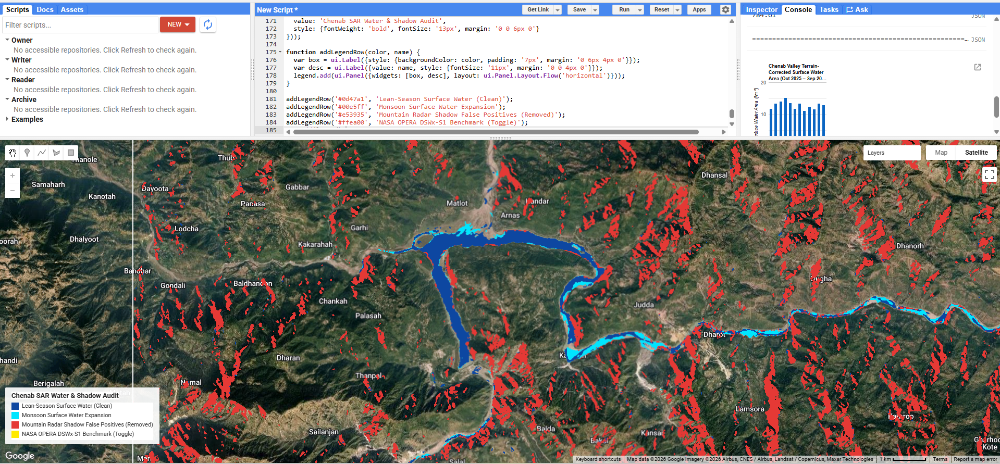
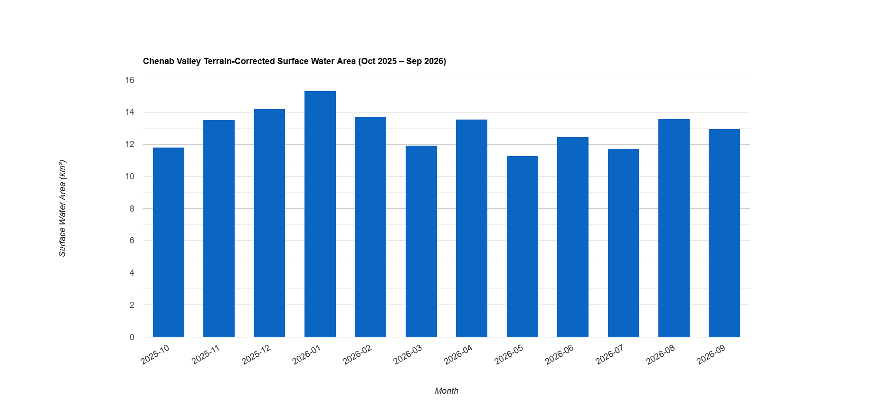

# Sentinel-1 SAR Surface Water Mapping & Terrain-Shadow Audit — Chenab Valley (J&K)

A cloud-based Synthetic Aperture Radar (SAR) remote-sensing workflow in **Google Earth Engine** evaluating surface water dynamics, steep-terrain radar shadow errors, and benchmark validation along the **Chenab River Corridor** (Pul Doda – Baglihar – Ramban – Salal – Akhnoor, Jammu & Kashmir) across the 2025–2026 hydrological cycle.

## Key Quantitative Results (Dec 2025 – Sep 2026)

| Metric | Value |
|---|---|
| **Sentinel-1 GRD Scenes (Lean: Dec 2025 – Feb 2026)** | 25 descending IW VV scenes |
| **Sentinel-1 GRD Scenes (Monsoon: Jul – Sep 2026)** | 29 descending IW VV scenes |
| **NASA OPERA DSWx-S1 Benchmark Scenes (Monsoon)** | 11 scenes |
| **Naive SAR Water Area (Before DEM Slope Mask)** | 243.73 km² |
| **Mountain Radar Shadow False Positives Removed** | 207.52 km² (**85.1% reduction**) |
| **Terrain-Corrected Monsoon Water Area** | 13.06 km² |
| **Terrain-Corrected Lean-Season Water Area** | 14.30 km² |
| **Monsoon Seasonal Water Expansion (New Inundation)** | 4.75 km² |
| **NASA OPERA DSWx-S1 Monsoon Water Extent** | 36.42 km² |
| **NASA OPERA Layover/Shadow Masked Area** | 784.61 km² |

---

## Physical & Remote Sensing Interpretation

1. **Why Naive SAR Thresholding Fails in Himalayan Gorges (85.1% False Positives):**
   Smooth open water acts as a specular reflector, producing low VV backscatter (`< -16 dB`). However, steep valley slopes shielded from Sentinel-1's side-looking radar beam cast dark **radar shadows** that mimic water signatures. Masking terrain steeper than `15°` with SRTM 30 m DEM eliminated **207.52 km²** of mountain-shadow false positives.
2. **Seasonal Backscatter & Turbulence Dynamics:**
   Although monsoon inundation added **4.75 km²** of new surface water relative to winter, total terrain-corrected median monsoon water area (**13.06 km²**) sat slightly below the lean-season median (**14.30 km²**). Two physical factors drive this: (a) wind-roughened surfaces and fast, turbulent monsoon rapids increase VV Bragg scattering above `-16 dB`, causing fixed-threshold omission in high-energy gorges, and (b) calm winter impoundment behind hydropower reservoirs (Baglihar and Salal) produces consistently smooth, radar-dark water surfaces.
3. **Benchmarking Against NASA OPERA DSWx-S1:**
   NASA's **OPERA DSWx-S1** product (derived from Radiometric Terrain Corrected `RTC-S1` bursts using the Copernicus GLO-30 DEM) reported **36.42 km²** of monsoon water and flagged **784.61 km²** of severe layover/shadow across the corridor. The wider water extent relative to the GRD median reflects OPERA's maximum-extent compositing (capturing transient monsoon peak flows), dual-pol/inundated-vegetation classification, and **HAND (Height Above Nearest Drainage)** masking rather than a hard `15°` slope cutoff that can clip narrow canyon banks.

---

## Visual Outputs

### 1. Chenab Valley SAR Surface Water & Mountain Shadow False-Positive Map


### 2. Monthly Surface Water Area Time Series (Oct 2025 – Sep 2026)


---

## Methodology

1. **Orbit & Polarisation Consistency:** Filtered `COPERNICUS/S1_GRD` strictly to Interferometric Wide Swath (`IW`), `VV` polarisation, and `DESCENDING` orbit pass to preserve uniform viewing geometry across seasons.
2. **Speckle Filtering:** Applied temporal median compositing followed by a `30 m` circular focal-median filter and connected-component denoising (`>= 5` contiguous pixels).
3. **DEM Terrain Correction Audit:** Contrasted raw VV thresholding (`< -16 dB`) against an SRTM 30 m slope mask (`< 15°`) to isolate and quantify steep-terrain shadow artefacts.
4. **Independent NASA Validation:** Cross-checked monsoon extent and geometric distortion zones against NASA JPL's `OPERA/DSWX/L3_V1/S1` water (`classes 1 & 3`) and layover/shadow (`class 251`) layers.

## Limitations & Error Sources
* **Fixed Backscatter Threshold (`-16 dB`):** A static global threshold introduces omission errors where wind-roughened reservoir surfaces or turbulent monsoon rapids scatter VV backscatter above `-16 dB`, and commission errors over smooth dry sandbars or paved surfaces.
* **Hard Slope Cutoff (`< 15°`):** While SRTM slope masking removed 85.1% of steep-terrain radar shadows, a strict `15°` cutoff can also clip genuine water pixels along narrow, steep-walled Chenab canyon riverbanks.
* **GRD Geometry vs. Full RTC:** `COPERNICUS/S1_GRD` scenes in Earth Engine are orthorectified to $\sigma^0$ without radiometric terrain flattening ($\gamma^0$), and restricting analysis to descending passes leaves west-facing slopes more prone to foreshortening and shadow.
* **Median vs. Peak Compositing:** Seasonal median compositing suppresses radar speckle effectively but smooths out short-lived flash-flood peaks (unlike NASA OPERA DSWx-S1's maximum-extent union).

## Data Sources & Provenance
* **Copernicus Sentinel-1 SAR GRD (ESA):** Earth Engine ID `COPERNICUS/S1_GRD` — [GEE Data Catalog](https://developers.google.com/earth-engine/datasets/catalog/COPERNICUS_S1_GRD) *(Accessed: November 2026)*
* **NASA OPERA Dynamic Surface Water Extent from Sentinel-1 (DSWx-S1) V1 (NASA JPL):** Earth Engine ID `OPERA/DSWX/L3_V1/S1`, DOI: `10.5067/OPDSWS1-L3V1` — [GEE Data Catalog](https://developers.google.com/earth-engine/datasets/catalog/OPERA_DSWX_L3_V1_S1) *(Accessed: November 2026)*
* **USGS SRTMGL1 30 m Digital Elevation Model (NASA / USGS):** Earth Engine ID `USGS/SRTMGL1_003` *(Accessed: November 2026)*

---

## Repository Structure

```text
chenab-sar-water-hazard/
├── scripts/
│   └── chenab_s1_water_hazard.js       
├── outputs/
│   ├── chenab_sar_shadow_map.png       # Spatial audit map (water vs. removed shadows)
│   └── chenab_monthly_water_area.png   # 12-month surface water area time series
└── README.md
